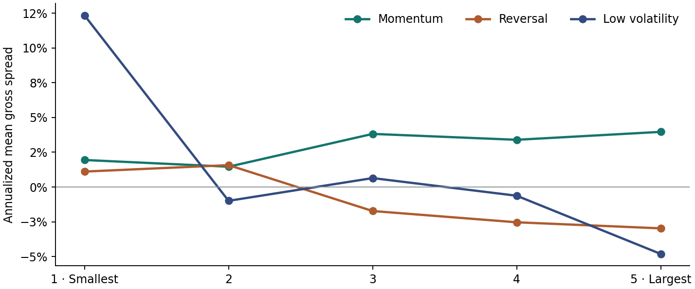

# Does equity factor performance survive a large-cap mandate?

**U.S. equity factor research | Python and SQLite | January 2005–September 2026**

The practical decision is whether to use momentum, one-month reversal or low volatility to tilt a large-cap portfolio. This study measures how gross factor spreads vary with market capitalization and whether a more defensive portfolio can improve risk-adjusted performance even when its raw spread is negative.



## Findings

| Signal, largest size quintile | Annualized arithmetic spread | Gross Sharpe | HAC t | 95% interval for annualized mean |
|---|---:|---:|---:|---:|
| Momentum | 3.97% | 0.17 | 0.74 | −6.5% to 14.4% |
| Short-term reversal | −2.97% | −0.16 | −0.71 | −11.2% to 5.3% |
| Low volatility | −4.81% | −0.23 | −0.98 | −14.5% to 4.8% |

* **The low-volatility spread depends on the mandate.** Low minus high variance averaged +12.34% annualized in the smallest size quintile and −4.81% in the largest. The paired difference was 17.16 percentage points (HAC t = 3.68). In a time-series regression on market excess return, SMB and HML, the annualized intercept of that difference was 16.55% (HAC t = 3.78). This is a historical interaction; multiple comparisons, omitted exposures and implementation costs limit interpretation.
* **The portfolio objective changes the verdict.** Among large caps, the least volatile quintile had 11.5% realized volatility and a 0.64 excess-return Sharpe, versus 23.7% and 0.52 in the most volatile quintile. The second quintile's Sharpe was 0.77. The low-volatility leg reduced risk without maximizing raw return or delivering the highest Sharpe among the five legs.
* **Momentum had recognizable exposure and substantial downside.** Its correlation with French Mom was 0.87, while April 2009 alone produced a −29.6% large-cap spread. Reversal correlated 0.81 with ST_Rev and had a negative full-sample mean even before costs. Shared source data make these construction checks, not independent validation.

## Design and data

Each month has three independent 5 × 5 size/signal sorts, giving 75 published portfolio cells and 19,575 portfolio-month returns. A cell is a portfolio, and a stock may contribute to multiple sorts. The largest size quintile is a historical U.S. large-stock proxy. Eligibility follows the source's historical portfolio formation. Index membership and individual security identities are unavailable here. Each cell uses value-weighted monthly returns. The signal buckets use source breakpoints and can have unequal numbers of stocks within a size bucket.

| Signal | Inputs used to form portfolios for holding month h | Positive spread direction |
|---|---|---|
| Momentum | Cumulative return over h−12 through h−2 inclusive | Q5 minus Q1 |
| Reversal | Return in h−1 | Q1 minus Q5 |
| Low volatility | Variance over the 60 daily observations through prior month-end, minimum 20 valid observations | Q1 minus Q5 |

The French file month already labels the holding return. Applying another lag would move the result to the wrong month. The secondary security-level script uses formation-month labels and explicitly shifts its outcome forward. The study uses a single revised historical vintage. Real-time vintage replication, sector neutrality, bid/ask execution and delisting verification at security level remain outside its evidence.

## Reproduce the published analysis

Python 3.11+ from this directory in PowerShell, Terminal or VS Code:

```sh
python -m pip install -r requirements.txt
python research.py
python risk_model.py
python figures.py
python -m unittest discover -s tests -v
```

The SQLite snapshot supports offline analysis after dependencies are installed. To audit the upstream import, run `python data.py`. It verifies six ZIP hashes against `data/sources.json` and refuses a different archive vintage. Official source files can change over time. Each archive's URL and creation header are recorded. The frozen tables can always reproduce the included results. Returns in the database and CSVs are decimals.

```sql
SELECT month, signal_q, ret
FROM portfolios
WHERE signal = 'Low volatility' AND size_q = 5
ORDER BY month, signal_q;
```

## Measurement

* Spreads use $1 long and $1 short per $1 capital. Gross spread returns omit financing frictions, cash yield and borrow fees. Treat the spread as an excess payoff and divide its mean by its standard deviation to compute Sharpe, scaled by the square root of 12. Long-only Sharpe uses the monthly French risk-free rate. Annualized arithmetic mean is 12 times the monthly average. Drawdown and event returns compound monthly spread returns on a hypothetical rebalanced account.
* The primary mean and paired size-gap tests use Bartlett/Newey–West standard errors with six monthly lags and asymptotic 95% intervals. The gap pairs deep-small and large-stock spreads in the same month. Three-factor OLS uses the same HAC convention. The study is retrospective and reports all three signals, all size buckets and all stated subperiods. Confidence intervals are pointwise.
* Costs are sensitivities. At 10 bps per dollar traded, buying and selling a total of $1 per $1 NAV monthly subtracts 1.2 percentage points from the annualized arithmetic mean. Outputs cover 5/10/20 bps and 0.5/1/2/4 dollars of assumed monthly trading per NAV. Constituent turnover, capacity and actual net returns require holdings and execution data.
* The full results include 2005–12, 2013–19, and 2020–September 2026; the 2008–09 period, April 2009, March 2020 and 2022 are descriptive stress windows. A single event illustrates exposure and cannot establish its cause.

## Evidence and extensions

| File | What to inspect |
|---|---|
| `memo.pdf` | One-page investment research memo |
| `results/spreads.csv`, `quintiles.csv` | All size buckets, subperiods, long-only legs and risk-adjusted comparisons |
| `results/small_minus_big.csv`, `risk_adjusted_size_gap.csv` | Paired size gaps and risk-model intercepts |
| `results/large_monthly.csv`, `spread_paths.png` | Reconstruct the largest-size spread and drawdown month by month |
| `results/correlations.csv`, `events.csv`, `cost_scenarios.csv` | Benchmark alignment, stress tests and trading-cost sensitivity |
| `stock_panel.py` | Optional security-level rank IC for a supplied historical universe |
| `tests/` | Data coverage, sign, units, drawdown, missing outcomes, timing and rank IC |

For the optional IC extension, supply columns `month,security_id,monthly_ret,vol60,eligible`. Use YYYY-MM, permanent security identifiers, decimal total returns including delisting outcomes, trailing daily-return volatility at each formation close, and historical eligibility flags (0/1). Keep full histories and held-month returns after an eligibility exit. Record zero for a flat return only if observed. Call `python stock_panel.py panel.csv ic.csv`. Missing outcomes for selected stocks stop the run. The tests use toy observations. The published study makes no claim about individual-stock IC, realized trading costs or alternative signal windows.

Data and construction notes: [Kenneth R. French Data Library](https://mba.tuck.dartmouth.edu/pages/faculty/ken.french/data_library.html). Project code, database schema, statistical comparisons and exhibits are original to this research package. The underlying portfolio returns are public research inputs.
